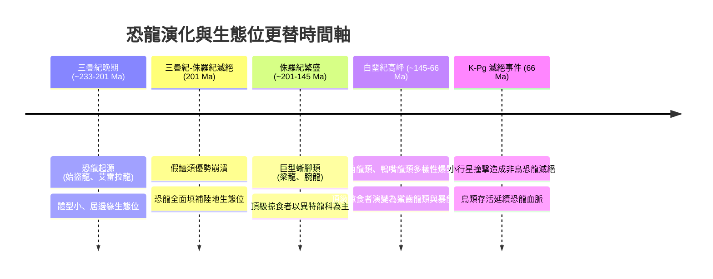

# 恐龍的起源與演化 (Origin and Evolution of Dinosaurs)

> **導讀簡介**：恐龍誕生於約 2.3 億年前的三疊紀晚期卡尼階（Carnian），歷經中生代三個地質紀的劇烈環境動盪，從低矮敏捷的小型雙足獵手演化為支配地球陸地生態系逾 1.6 億年的龐大爬行動物類群。

---

## 1. 起源背景：從主龍類到恐龍祖先

在二疊紀—三疊紀大滅絕（P-Tr extinction event）後，地球生態系空出了大量生態位。雙孔亞綱中的**主龍形下綱／主龍類 (Archosauria)** 開始迅速多樣化，主要分支包括：
1. **假鱷類 (Pseudosuchia)**：鱷魚的古老祖先支系，在三疊紀佔據多數大型陸生肉食與植食生態位。
2. **鳥頸類主龍 (Avemetatarsalia)**：涵蓋翼龍目 (Pterosauria) 與**恐龍形態類 (Dinosauromorpha)**。

約在 2 億 3,300 萬年前的三疊紀晚期，最原始的恐龍成員（如南美洲發現的**始盜龍 *Eoraptor***、**艾雷拉龍 *Herrerasaurus***）正式出現。早期恐龍具備以下關鍵競爭優勢：
* **四肢完全直立 (Erect Stance)**：股骨頭呈 90 度彎曲深入骨盆髖臼，四肢直立於軀幹正下方（不同於蜥蜴向外攤開的爬行姿態），大幅節省運動能耗。
* **高效率雙足奔跑 (Bipedal Locomotion)**：解放前肢並具備靈活捕捉能力。
* **發達呼吸系統**：演化出類似鳥類的氣囊輔助單向流呼吸雛形，在三疊紀低氧環境中維持高代謝率。

---

## 2. 中生代三大地質紀演化歷程

### 三疊紀晚期 (Late Triassic)：低調起步
早期恐龍體長多在 1 至 3 公尺之間，生活在大型副鱷形類（如勞氏鱷科 Rauisuchidae）與大型二齒獸類的陰影下。三疊紀末期（約 2 億 100 萬年前）的大滅絕重創了偽鱷類，為恐龍的全面崛起掃清了競爭障礙。

### 侏羅紀 (Jurassic)：巨型化與霸權建立
進入侏羅紀，地球氣候溫暖濕潤，裸子植物繁盛。
* **植食性奇蹟**：**蜥腳下目 (Sauropoda)** 演化出極度龐大的體型（體重可達數十公噸），藉由長頸採食高處針葉樹冠。
* **掠食者演進**：以**異特龍科 (Allosauridae)** 與斑龍科 (Megalosauridae) 為代表的堅尾龍類，成為陸地食物鏈頂層主宰。

### 白堊紀 (Cretaceous)：多樣性頂峰與生態位更替
白堊紀被子植物（開花植物）崛起，引發了食草性恐龍的全新適應輻射：
* **新型食草家族**：具備「齒電池」研磨結構的**角龍下目 (Ceratopsia)** 與**鴨嘴龍科 (Hadrosauridae)** 興起，取代侏羅紀劍龍類的生態位。
* **掠食者演替歷程**：
  * **白堊紀早—中期**：異特龍超科的後裔**鯊齒龍科 (Carcharodontosauridae)** 與**棘龍科 (Spinosauridae)** 稱霸全球。
  * **白堊紀晚期**：虛骨龍類中的**暴龍超科 (Tyrannosauroidea)** 在北美與亞洲迅速巨型化，發展出極強的咬碎骨骼能力，最終取代大型肉食恐龍成為絕對頂級掠食者。

---

## 3. 參考文獻與來源 (References)
* [國立自然科學博物館 - 恐龍時代](https://www.nmns.edu.tw/ch/exhibitions/galleries/life-science-hall/the-age-of-dinosaurs/index.html)
* Benton, M. J. (2014). *Vertebrate Palaeontology* (4th ed.). Wiley-Blackwell.
* Brusatte, S. L. (2018). *The Rise and Fall of the Dinosaurs: A New History of a Lost World*. William Morrow.
